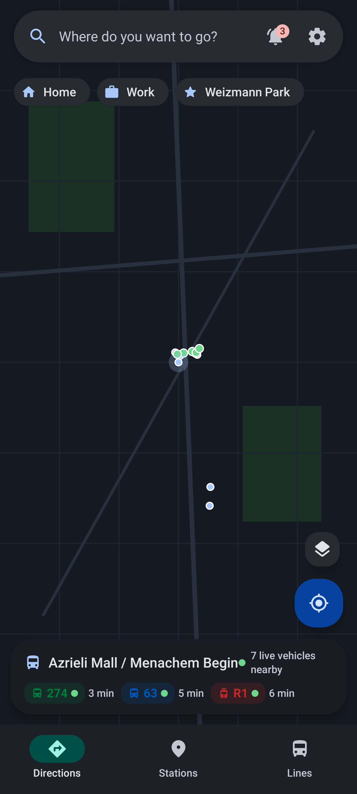
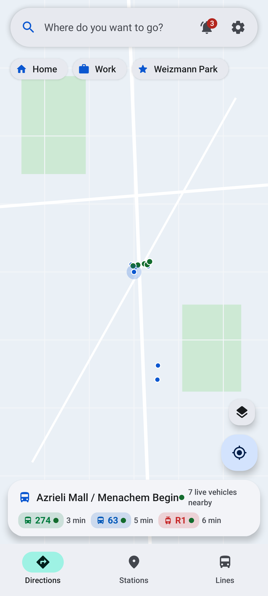
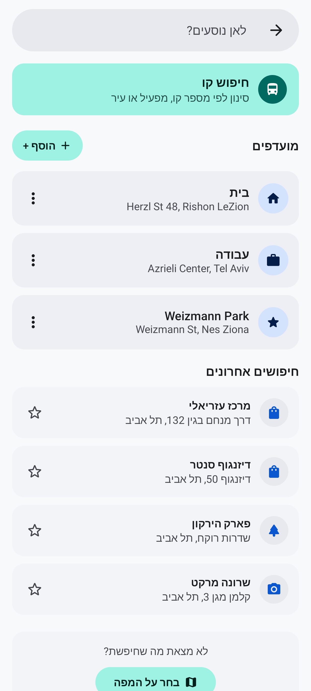
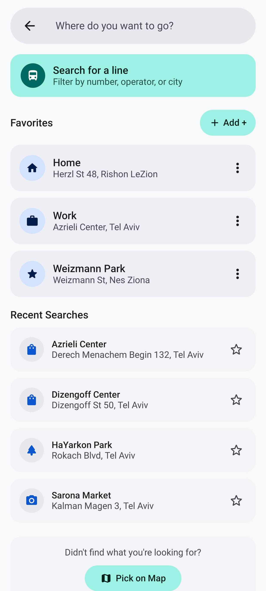
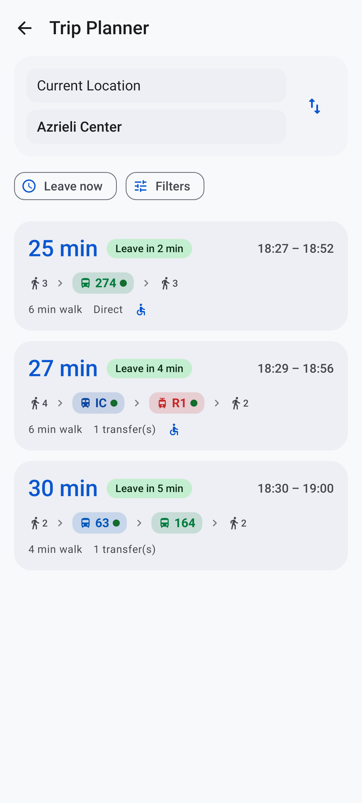
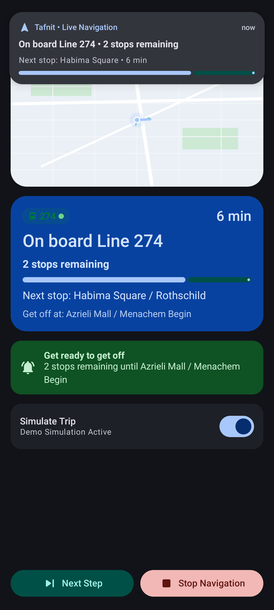
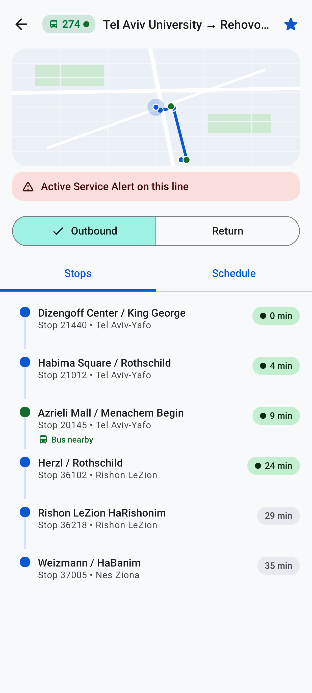
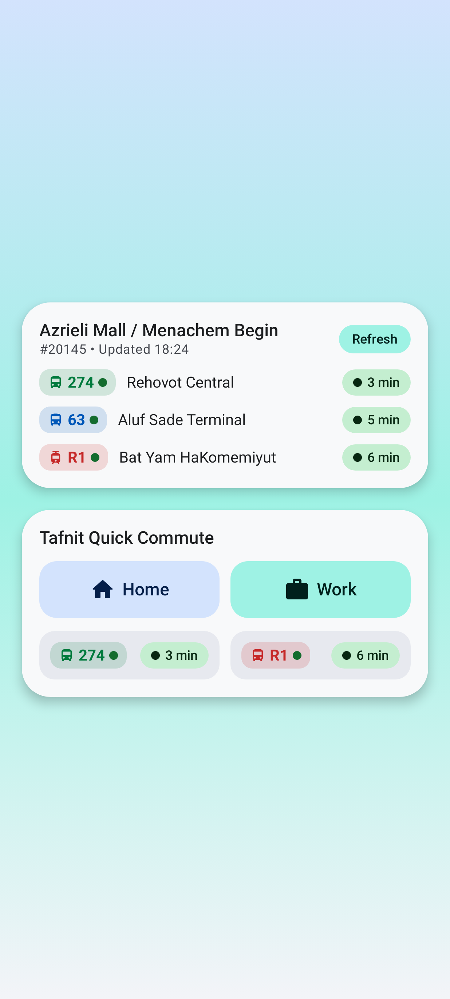

<div align="center">

# Tafnit • תפנית

**Fast, ad-free, open-source Material You public transit app for Israel**

[](https://kotlinlang.org)
[](https://developer.android.com/jetpack/compose)
[](https://developer.android.com)
[](LICENSE)
[](https://github.com/dor2500/tafnit/actions/workflows/android-build.yml)

</div>

---

## Screenshots

| Dark Mode (Material You) | Light Mode (Material You) | Search & Favorites (HE RTL) | Search & Favorites (EN LTR) |
| :---: | :---: | :---: | :---: |
|  |  |  |  |

| Trip Planner Routes | Live Navigation & Lock-Screen | Line Details & Timeline | Material You Glance Widgets |
| :---: | :---: | :---: | :---: |
|  |  |  |  |

---

## Key Features

- **Material You (Material 3) & Dynamic Color:** Wallpaper-adaptive `dynamicDarkColorScheme` / `dynamicLightColorScheme` on Android 12+, refined fallback palette on Android 8–11, edge-to-edge UI, tonal surface elevation, and Android 13+ monochrome themed launcher icon.
- **Full Bilingual Localization (עברית RTL / English LTR):** Instant in-app language switching via `AppCompatDelegate.setApplicationLocales` across every screen, dialog, notification, and widget.
- **Directions & Live Map (`מסלולים`):** Interactive OpenStreetMap (`osmdroid`) map with live moving transit vehicles, nearby stop pins, floating Material 3 search bar, quick-access `Home` / `Work` / custom favorite chips, and map layer switcher.
- **Smart Search & Favorites:** Debounced autocomplete for addresses, landmarks, 5-digit Israeli station codes (`מק"ט`), and line numbers; full Favorites CRUD with custom icon picker; interactive **Pick on Map** draggable pin screen.
- **Advanced Trip Planner:** Origin/destination swap, `Leave now` / `Depart at` / `Arrive by` date & time pickers, mode filters (Bus, Israel Railways, Light Rail Dankal/Kfir, Shuttle), route optimization (Fastest, Least Walking, Fewest Transfers, Wheelchair Accessible), comparison cards, and expandable multi-leg itinerary timelines.
- **Live Navigation & Get-Off Alerts:** Foreground Service (`LiveNavigationService`) with real-time leg tracking, persistent lock-screen progress notification, configurable Get-Off Alerts (2 stops before, 1 stop before, arrival) with sound & vibration, and built-in **Simulate Trip** demo mode.
- **Stations & Lines (`תחנות` / `קווים`):** Nearby stops sheet, Station Details with Live GPS vs Scheduled arrivals & full timetable, Line Details with outbound/return direction switcher, stops timeline, live bus indicators, and Service Alerts.
- **Jetpack Glance Widgets:** `TafnitNearbyWidget` (closest stop + next 3 live arrivals + refresh) and `TafnitCommuteWidget` (one-tap Home, Work, and favorite lines).
- **100% Transit Focused:** Zero ads, zero payments, zero Rav-Kav upsells, zero tracking.

---

## Architecture & Tech Stack

- **Pattern:** Clean Architecture + MVVM (`ui` → `domain` → `data`) with unidirectional data flow (`StateFlow`).
- **UI:** Jetpack Compose BOM, Material 3, Material Icons Extended, Navigation Compose (type-safe routes), Jetpack Glance.
- **DI & Async:** Hilt, Kotlin Coroutines & Flow, WorkManager (`HiltWorker`).
- **Storage:** Room Database (`FavoritePlace`, `FavoriteStop`, `FavoriteLine`, `RecentSearch`) + DataStore Preferences.
- **Networking & Data:** Retrofit + OkHttp + Kotlinx Serialization:
  - **OpenBus Stride API** (`open-bus-stride-api.hasadna.org.il`) for Israeli GTFS stops, routes, and SIRI live vehicle locations.
  - **Photon Geocoder** (`photon.komoot.io`) for free OpenStreetMap address & POI search biased toward Israel.
  - **Offline Israeli Demo Dataset:** Built-in realistic Central Israel / Jerusalem / Haifa transit dataset so every feature works seamlessly out of the box even offline.

---

## Build & Run

1. **Requirements:** Android Studio Ladybug+ (or JDK 17 + Android SDK 36).
2. **Clone & Build:**
   ```bash
   git clone https://github.com/dor2500/tafnit.git
   cd tafnit
   ./gradlew assembleDebug
   ```
3. **Generate Roborazzi Screenshots:**
   ```bash
   ./gradlew recordRoborazziDebug
   ```

---

## Roadmap

- [ ] Wear OS companion tile & live trip glance
- [ ] Community crowding & accessibility reports
- [ ] Offline GTFS-schedule bundle downloader
- [ ] Android Auto transit arrival cards

---

## License

Licensed under the [MIT License](LICENSE).
